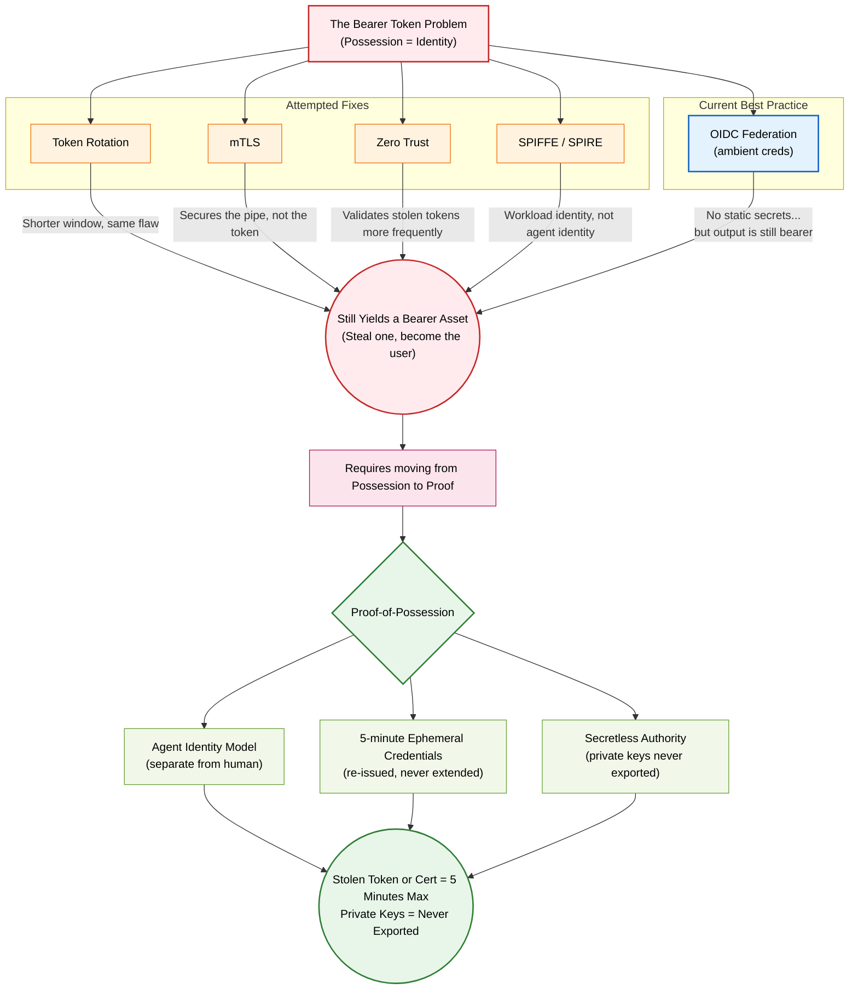
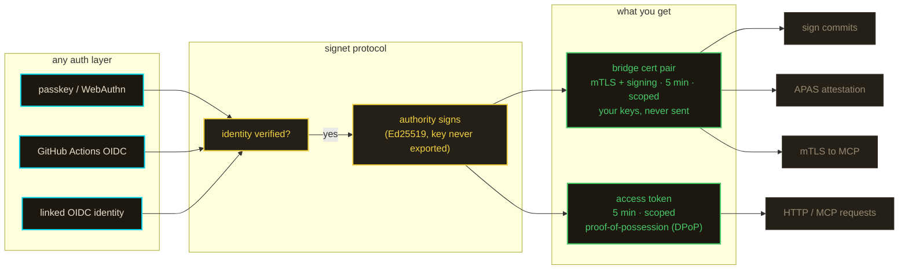
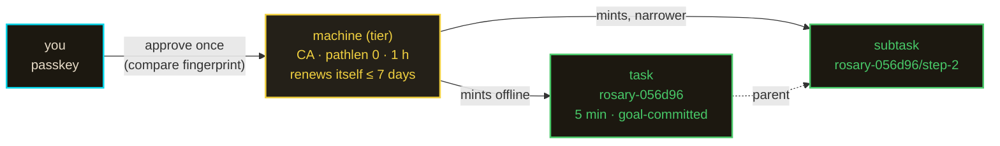

<!--
@doc-check
@types: CABundle, BridgeCertResult, CertScope
@endpoints: POST /cert, POST /cert/gha, POST /cert/nonce, POST /token, GET /authorize, GET /me, POST /invites, POST /cert/issuing-ca/device, POST /cert/issuing-ca/renew, GET /enroll, POST /bootstrap/claim, GET /.well-known/signet-authority.json, GET /.well-known/jwks.json, GET /.well-known/ca-bundle.pem, GET /api/docs
-->
# notme

> **experimental** — under active development. not audited. see [SECURITY.md](SECURITY.md).

your agents are you. they shouldn't be.

every AI coding tool uses your credentials. your PAT, your SSH key, your OAuth token. when the agent is compromised, the attacker is you. there's no separation, no scope, no revocation.

notme is the identity layer that fixes this. agents get their own cryptographic identity — scoped, ephemeral, revocable (a grant on the next request, a machine at its next renewal), distinct from the human who deployed them.

under the hood, notme is an identity **normalizer**. bring auth you already passed — a passkey, a GitHub Actions OIDC token, or an OIDC identity you've linked to your passkey — and it re-issues that identity as a **standard** credential the rest of your stack already speaks: an X.509 bridge certificate (mTLS today; scoped for git signing and attestation) or a DPoP-bound OAuth access token ([RFC 9449](https://www.rfc-editor.org/rfc/rfc9449)) for HTTP and MCP. one Ed25519 authority signs both, and its private key is never exported — no HTTP route or RPC method returns it.

mechanically it's a bridge **certificate authority** *and* an OAuth **authorization server** over a single root — and deliberately **not** an OpenID provider. it never vends a third party a bearer claim about who you are; it converts auth you already proved into proof-of-possession you can't hand off by copying.

## why



## how it works



the authority doesn't care how you authenticated. it cares that you did. each supported proof feeds the same protocol — the output is a scoped, ephemeral, proof-of-possession credential: a cert pair over keys you generated, or a DPoP-bound token. the authority's signing key is never exported.

## agents, machines and tasks

an agent never holds your identity, and never holds the power to mint one. three tiers, each narrower than the last:



- **you** approve a machine once, with a passkey. that's the only human step.
- **the machine** holds a *tier*: a short-lived CA that can mint task certs but no further CAs. it is approved with a **renewal horizon** (1, 7 or 30 days, default 7) and renews itself, by proof of possession, for as long as that approval holds.
- **each task** gets its own cert pair, minted offline by the machine: identity `…/principal/<you>/<task>`, 5 minutes by default, carrying the task id and a SHA-256 of its goal (OID `.1.9`). a task cert is a leaf (`CA:FALSE`): it cannot issue anything.
- **subtasks** are derived from a parent task by the machine — never by the agent — and can only narrow: scopes ⊆ the parent's, lifetime ≤ the parent's, name prefixed by the parent's. a re-mint is the same operation keeping the parent's name.

**scopes only narrow, and it is checked at every mint:** your *live* grants ∩ what a cert may carry (`bridgeCert`, `sign:git`, `sign:attestation` — never `certMint` or `authorityManage`) → the tier → each task → each subtask.

**pause and resume.** a VM that pauses past its tier's lifetime resumes, renews with no human, and carries on. it needs a human again only when the approval ends — and it says why:

| renewal refused | because | to continue |
|---|---|---|
| `revoked` | you revoked the machine | `enroll` again |
| `horizon_passed` | the 1/7/30 days ran out | `enroll` again |
| `epoch_changed` | the authority's mass-revocation lever was pulled | `enroll` again |
| `approval_withdrawn` | you no longer hold `certMint`, or the granted scopes | restore the grant, or `enroll` |
| `fork_detected` | a copy of this machine renewed; the enrollment is shut off | `enroll` again |

the machine's tier key is the approval: whoever holds it can renew until you revoke the machine or the horizon passes. pick the shortest horizon that covers your pauses.

**revocation levers, narrowest first:**

| lever | reaches | takes effect |
|---|---|---|
| `task-cert revoke --task X` | X and everything under it, on that machine | next mint; issued certs live out ≤ 5 min |
| `POST /cert/issuing-ca/enrollments/revoke` | one machine | next renewal (≤ 1 h) |
| fork detection | one machine, automatic | at the copy's next renewal |
| revoke a grant | every machine that grant approved | next renewal |
| `POST /admin/revoke-epoch` | everything this authority issued | ≤ 5 min for online verifiers |

### try it

```bash
task task-cert -- enroll --scopes bridgeCert,sign:git   # link + fingerprint; approve with your passkey
task task-cert -- mint --task build --goal "ship the release" --scopes bridgeCert,sign:git
task task-cert -- mint --parent build --task compile --goal "compile"   # a subtask, narrower
task task-cert -- verify --cert ~/.notme/tasks/build/compile/signing.pem
task task-cert -- status                     # tier, renewal horizon, mints, revocations
```

a machine requests `bridgeCert` alone unless `enroll --scopes` asks for more, and gets only what you hold. keys and certs live under `~/.notme/` (dir 0700, keys 0600), never in the working directory. every mint is recorded in `~/.notme/tasks/ledger.jsonl`. `openssl verify -CAfile root.pem -untrusted ~/.notme/tier/tier.pem task.pem` checks a task cert without any notme code.

**in CI**, a GitHub Actions job needs no enrollment: its OIDC token is the evidence. `POST /cert/gha` exchanges it for a cert pair, and `POST /token` (RFC 8693 token exchange) for a DPoP-bound access token.

## what's here

```
worker/             identity authority — auth.notme.bot (CF Worker + Durable Objects)
  src/                auth modules (passkey, DPoP, session, OIDC, principals)
  src/platform.ts     runtime abstraction (CF edge vs local workerd)
  e2e/                Playwright contract tests (virtual authenticator)
proxy/              Rust mTLS forward proxy — bridge cert lives in process memory,
                    workerd Workers fetch() through it. TCP or UDS listen.
action/             GHA action — OIDC → bridge cert pair (zero secrets, zero files)
scripts/task-cert/  machine-side CLI — enroll, renew, mint tasks and subtasks, verify
gen/ts/             shared SDK — base64url, validateClaims, computeJwkThumbprint
schema/             cap'n proto type definitions (CABundle, GHAClaims, etc.)
packages/           container image pipeline (melange + apko) + workspace libs (contract, dpop)
docs/design/        ADRs 005–022
```

see [ARCHITECTURE.md](ARCHITECTURE.md) for the full subsystem map, data flow, and security model.

## endpoints (auth.notme.bot)

| method | path | what |
|--------|------|------|
| `POST` | `/cert/gha` | GHA OIDC → bridge cert pair (secretless — keys generated by the caller) |
| `POST` | `/cert` | passkey session (+ nonce), linked OIDC identity, or bootstrap → cert pair or token |
| `POST` | `/cert/nonce` | session-bound nonce for a cert-pair proof |
| `POST` | `/cert/passkey` | passkey session (+ nonce) → bridge cert pair |
| `POST` | `/token` | DPoP-bound access token (RFC 9449): browser session, or RFC 8693 token exchange of a GHA OIDC token |
| `POST` | `/cert/issuing-ca/device` | a machine starts enrollment → code + fingerprint |
| `GET` | `/enroll` | approve a machine with your passkey; choose its renewal horizon |
| `POST` | `/cert/issuing-ca/device/token` | the machine collects its tier |
| `POST` | `/cert/issuing-ca/renew` | the machine renews its tier, no human, while the approval holds |
| `GET` | `/cert/issuing-ca/enrollments` | your machines |
| `POST` | `/cert/issuing-ca/enrollments/revoke` | stop a machine renewing |
| `POST` | `/bootstrap/claim` | first boot: the named workflow approves a passkey claim |
| `GET` | `/authorize` | OAuth-style redirect for cross-origin token issuance |
| `POST` | `/auth/passkey/register/*` | WebAuthn passkey registration |
| `POST` | `/auth/passkey/login/*` | WebAuthn passkey login |
| `GET` | `/me` | current session info (JSON or HTML) |
| `POST` | `/invites` | create scoped invite (requires authorityManage) |
| `GET/POST` | `/join` | redeem invite |
| `GET/POST` | `/connections` | link an OIDC identity or X.509 cert to your passkey |
| `GET` | `/.well-known/signet-authority.json` | authority discovery |
| `GET` | `/.well-known/jwks.json` | Ed25519 public key (JWK Set) |
| `GET` | `/.well-known/ca-bundle.pem` | X.509 CA certificate |

## run your own

three ways — same code, same behavior.

**local (workerd)**
```bash
pnpm install
task worker:serve      # builds the dpop lib + bundle, then runs workerd
# → http://localhost:8788
```

**container (published image)**
```bash
docker run -p 8788:8788 ghcr.io/agentic-research/notme:0.2.0
curl localhost:8788/health    # → 200 ok
```

Multi-arch (x86_64 + aarch64), distroless, and cosign-signed. Verify the
signature before running it:

```bash
cosign verify ghcr.io/agentic-research/notme:0.2.0 \
  --certificate-identity-regexp '^https://github\.com/agentic-research/notme/\.github/workflows/release\.yml@' \
  --certificate-oidc-issuer https://token.actions.githubusercontent.com
```

The identity pins the **release workflow**, not just the repository. The
previous pattern (`^https://github.com/agentic-research/notme/`) had no
terminator, so it matched *any* workflow in the repo — and any workflow with
`id-token: write` could have produced a signature that passed it. Dots are
escaped for the same reason: unescaped, `.` matches any character.

The mTLS forward proxy ships as its own image, since a cloister cluster runs
it as a separate bundle:

```bash
docker run ghcr.io/agentic-research/notme-proxy:0.2.0 \
  --cert /run/notme/bridge-cert.pem \
  --key  /run/notme/bridge-key.pem \
  --listen 127.0.0.1:1080
```

**container (build it yourself)**
```bash
task image              # bundles worker, signs apks, builds notme:0.1.0 OCI tar
docker load < packages/notme.tar
docker run -p 8788:8788 notme:0.1.0

task image:proxy        # same, for notme-proxy
docker load < packages/notme-proxy.tar
```

`task image` wraps the full pipeline (`worker:build-local` → melange apks →
apko OCI tarball) and builds for the host arch only. Override the tag with
`task image TAG=mytag`. Requires `apko`, `melange`, and a running Docker
daemon. See [`packages/README.md`](packages/README.md) for the recipes and the
publish path.

**cloudflare workers**
```bash
cd worker
cp wrangler.toml.example wrangler.toml
# edit wrangler.toml — set your CF KV namespace ID
wrangler deploy
```

CA key is generated on first request. On Cloudflare it persists in the Durable Object's storage (encrypted at rest by Cloudflare; set `NOTME_KEK_SECRET` to also wrap it under a key you hold). In ephemeral mode (local/container), the private key exists only in process memory — `cat *.sqlite | strings | grep '"d"'` returns nothing.

**first boot — no secret.** set `BOOTSTRAP_GHA_SUBJECT` (a var, e.g. `repo:you/notme:ref:refs/heads/main`), open `/login`, and register a passkey: on an authority with no administrator it becomes a **claim** holding nothing, and the page shows a code. then

```bash
gh workflow run claim-authority.yml -f code=XXXX-XXXX
```

and sign in again — you are the administrator. nothing is set, typed or logged; GitHub attests the deployer, your passkey holds the credential. `BOOTSTRAP_CODE` (a secret) remains as break-glass. see [docs/FLOWS.md §3](docs/FLOWS.md).

## testing

```bash
task worker:check      # typecheck + unit/adversarial tests + real-Durable-Object tests
task docs:check        # every annotated doc claim checked against the code
task proxy:check       # Rust proxy: build, test, clippy
cd worker && bash test-local.sh   # workerd smoke test
cd worker && bash test-e2e.sh     # Playwright e2e (virtual authenticator)
```

## repo layout

| Subdir | What | README |
|---|---|---|
| `worker/` | Cloudflare Worker — edge plane (TS). Same code runs at CF prod and local workerd. | [worker/README.md](worker/README.md) |
| `proxy/` | Local plane (Rust). Holds the bridge-cert private key in process memory. | [proxy/README.md](proxy/README.md) |
| `action/` | GitHub Action — `notme/action@<sha>`. CI-side identity exchange. | [action/README.md](action/README.md) |
| `schema/` | Cap'n Proto schemas — declared single source of truth for cross-language types. | [schema/README.md](schema/README.md) |
| `gen/` | Generated TS + Go from `schema/`. Don't edit manually. | [gen/README.md](gen/README.md) |
| `wasm/` | Empty and superseded — `leyline_sign.wasm` ships from ley-line-open instead. Kept as history. | [wasm/README.md](wasm/README.md) |
| `scripts/` | Standalone tooling: `task-cert/` (machine-side CLI), `doc-check.ts`, etc. | [scripts/README.md](scripts/README.md) |
| `packages/` | melange + apko signed container bundles, plus the `contract` and `dpop` workspace libraries. | [packages/README.md](packages/README.md) |
| `docs/design/` | ADRs 005–022. | [docs/README.md](docs/README.md) |

## related

- [signet](https://github.com/agentic-research/signet) — Go identity server, APAS spec, bridge cert protocol
- [auth.notme.bot](https://auth.notme.bot) — live authority
- [notme.bot](https://notme.bot) — the standard
