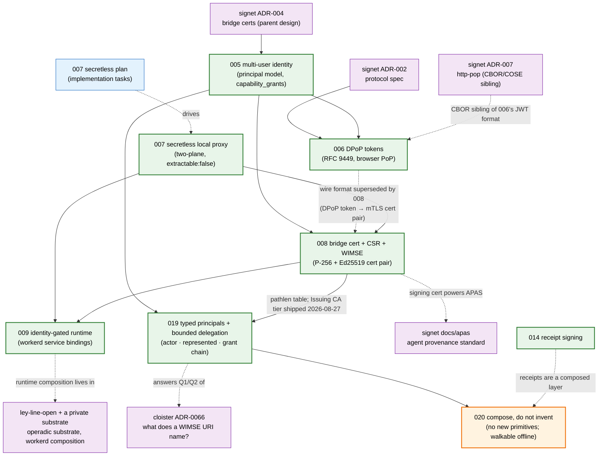

# docs

architecture decision records for notme.

## flows

[`THREADS.md`](THREADS.md) — the cross-repo order of operations: how notme,
signet and cloister's open work actually relates (from the beads' own
citations), seven threads, and which decisions gate which lines.

[`FLOWS.md`](FLOWS.md) — the eight paths that matter, as a cheat sheet: CI and
human enrollment, first boot, admin recovery, third-party verification,
revocation, bundle publication, and deploy. Each says what is live, what is
unwired, and the gotcha that bit us. Structure lives in
[`../ARCHITECTURE.md`](../ARCHITECTURE.md); rationale lives in the ADRs below.

## adr index

| # | title | status | one-line decision | code / files |
|---|---|---|---|---|
| **005** | [multi-user identity](design/005-multi-user-identity.md) | accepted | replace single-admin model with `principals` + `capability_grants` + invite flow; authority comes from grants (read live per request), with `is_admin` now only seeding a passkey user's first grant set — the Phase 3 table removals were not executed | `worker/src/auth/principals.ts`, `worker/src/auth/connections.ts` |
| **006** | [DPoP tokens](design/006-dpop-tokens.md) | accepted | sender-constrained JWT access tokens (RFC 9449); same Ed25519 master key signs certs and tokens | `worker/src/auth/dpop.ts`, `worker/src/auth/dpop-handler.ts`, `worker/src/auth/token.ts` |
| **007** | [secretless local proxy](design/007-secretless-local-proxy.md) | accepted (phase A done; phase C partial) | two-plane model — workerd holds non-extractable keys locally, edge validates independently; `extractable: false` invariant enforced everywhere | `worker/src/platform.ts`, `worker/src/signing-authority.ts`, `proxy/src/main.rs` |
| **007** | [secretless plan](design/007-secretless-plan.md) | implementation plan (sibling of design 007) | task-by-task TDD checklist for executing 007 | — (drives changes across `worker/`, `Taskfile.yml`) |
| **008** | [bridge cert + CSR + WIMSE](design/008-bridge-cert-csr-wimse.md) | accepted | proof-of-possession exchange producing a P-256 mTLS cert + Ed25519 signing cert with a shared binding extension; WIMSE identity URIs in SAN | `worker/src/cert-authority.ts`, `worker/src/cert-exchange.ts` |
| **009** | [identity-gated runtime](design/009-identity-gated-runtime.md) | accepted | workerd config pattern: agent Worker has no `globalOutbound`, talks to notme Worker via service binding only; agent cannot `fetch()` | `worker/config.capnp`, `worker/worker.ts` (`AuthService`) |
| **010** | [cross-language canonical encoding](design/010-cross-language-canonical-encoding.md) | accepted | CABundle signatures are computed over canonical CBOR, matching signet, instead of JSON; Cap'n Proto is type sync only, not the wire format; hard cutover chosen while pre-production (see the dated CORRECTION on the decision's fail-closed argument) | `worker/src/revocation.ts` (`bundleCanonical`), `schema/fixtures/` |
| **011** | [external OAuth provider](design/011-external-oauth-provider.md) | proposed | plan for notme as an external OAuth 2.0 / OIDC provider: endpoint inventory, gaps, proposed layout | — (plan; inventory points at `worker/worker.ts`) |
| **012** | [vault retirement](design/012-vault-retirement.md) | accepted | delete `vault/` from notme; cloister owns and deploys the credential vault | — (removal) |
| **013** | [authorization code + PKCE](design/013-authorization-code-pkce.md) | accepted | replace token-in-URL on the `/authorize` redirect with a single-use, S256 PKCE-bound code redeemed server-to-server | `worker/worker.ts` (`/authorize/code`, `/authorize/redeem`), `worker/src/signing-authority.ts` |
| **014** | [receipt signing](design/014-receipt-signing.md) | accepted | receipts are signed through a dedicated `ReceiptSigner` RPC entrypoint (no URL), and `signReceipt` parses, validates, derives `actor_fp`/`epoch` and re-encodes the commitment before signing — never a sign-these-bytes route | `worker/worker.ts` (`ReceiptSigner`), `worker/src/receipts/` |
| **015** | [delegated JWT signing](design/015-delegated-jwt-signing.md) | accepted | each delegated issuer gets its own Ed25519 key; the CA master key never signs a delegated JWT | `worker/src/signing-authority.ts` |
| **016** | [signing surfaces](design/016-signing-surfaces.md) | accepted (normative) | the general rules for any surface that signs with an authority key, generalized from 014 and 015 | — (rules; applied in 014, 015) |
| **017** | [sender-constrained OIDC](design/017-sender-constrained-oidc.md) | **proposed** | id_tokens that prove possession of a key (`cnf`) rather than presence of a bearer token | — (proposed) |
| **018** | [goal zero promotion](design/018-goal-zero-promotion.md) | accepted | staging Worker (own DOs/CA, no VPC) → version-id canary via gradual deployments → 100% promote; rollback = promote the old id; per-phase gates + release evidence bundle | `worker/wrangler.toml.example` (`[env.staging]`), `Taskfile.yml` (`ship-staging`, `worker:canary`, `worker:promote`), `worker/worker.ts` (`authorityHostFromEnv`) |
| **019** | [typed principals + bounded delegation](design/019-delegation-authority.md) | accepted | humans, agents, workloads and organizations are all stable principals; a credential names the key-holding ACTOR, any REPRESENTED principal, and the GRANT CHAIN. Ceremony/attestation/runtime/task are attributes, not identity (RFC 8693 delegation, not impersonation). Depth is bounded by a rank function (`pathLenConstraint`), NOT by scope narrowing. Corrects ADR-008 §299: URI `nameConstraints` bind the HOST, not the path, so the namespace bound is absent | `worker/src/auth/scope-chain.ts`, `worker/src/auth/correlation-key.ts`, `worker/src/delegation-depth.do.test.ts`, `worker/src/receipts/commitment.ts` |
| **020** | [compose, do not invent](design/020-compose-do-not-invent.md) | **proposed** | notme composes standardized certs, attestations, capabilities and content references and makes the graph walkable OFFLINE by a party that does not trust notme; it introduces no new signing algorithm, token, hash-chain, task store or completion state machine, and is never required as a verifier of statements it did not issue — but DOES own grant lifecycle, because that is revocation. Split out of ADR-019 D6 | `worker/src/receipts/`, `worker/src/auth/correlation-key.ts`, `docs/design/019-delegation-authority.md` |
| **021** | [registration policy](design/021-registration-policy.md) | accepted | registration is GATED and the gate is a policy decision about a subject, which notme does not own: signet's trust policy bundle (`sigpol`, ADR-011 §5.3) is the eventual answer, an invite is the interim mechanism, and `principal_kind` decides which kinds may self-register at all (workloads by attestation, humans by invite, agents by delegation) | `worker/worker.ts` (`/auth/passkey/register/options`), `worker/src/registration-gate.do.test.ts` |
| **022** | [client registration](design/022-client-registration.md) | **proposed** | OAuth client registration is a Client ID Metadata Document the client publishes and notme fetches, not a row notme stores | — (proposed) |

statuses here are summaries; each ADR's own `**Status:**` line is authoritative, and every design doc now carries one. 007, 008 and 009 say "partially implemented (audited 2026-08-04)" in their headers; the rows above describe what shipped. Every `docs/design/*.md` also carries a `@doc-check` block, so `task docs:check` verifies its listed types and endpoints and prints coverage — but it checks only those listed claims, not the prose.

## adr dependency graph

key edges:

- **005 → 006, 008** — the principal / scope model is the identity foundation; DPoP tokens and bridge certs both carry `principalId` + `scopes` derived from `capability_grants`.
- **007 → 008** — 008 builds on 007's "private keys never leave process memory" invariant; the PoP exchange relies on `extractable: false` keypairs generated client-side.
- **006 ⇢ 008** — 008's migration table explicitly retargets the wire format from "DPoP token" to "P-256 mTLS cert + Ed25519 signing cert". 006 isn't formally superseded (the `/token` endpoint and DPoP code paths still exist for browsers), but for CLI/CI/agent contexts 008 is the canonical answer.
- **007 + 008 → 009** — 009 is the runtime that consumes both: a notme Worker holding the cert pair from 008, an agent Worker isolated by the V8 boundary 007 set up.

## why numbering starts at 005

ADRs 001–004 live in **signet** (`signet/docs/design/`):

| # | title (signet) |
|---|---|
| 001 | signet tokens (CBOR+COSE PoP) |
| 002 | signet protocol specification |
| 003 | signet SDK |
| 004 | bridge certificates for federated identity |

notme inherits the numbering — it's the cloudflare-deployed implementation of signet's identity authority, so the ADR sequence continues. signet ADR-004 is the parent design notme ADR-005 (and onward) builds on. there was no historical reset; the lower numbers simply belong to the protocol repo, not the worker repo.

## the two `007-*` files

both files are live. neither is dead.

- **`007-secretless-local-proxy.md`** — the **design**. invariants, threat model, key-storage modes, blockers, success criteria. cite this when arguing about the model.
- **`007-secretless-plan.md`** — the **implementation plan**. checkbox-style task list (Task 1 build tooling, Task 2 platform interface, ...) intended to be consumed by the `superpowers:executing-plans` skill. cite this when actually doing the work.

they share a number because the plan is scoped to the design doc — keeping them as `007-design` + `007-plan` (rather than `007` + `010`) preserves citation stability and signals "these belong together."

this is the only shared number, and it is deliberate: there is one decision (007) and one companion plan, so it is not a duplicate ADR. the other collision the 2026-08-04 audit found (`notme-3ef3af`) — two 012s — was resolved by renumbering the proposed sender-constrained-OIDC ADR to 017; `012-vault-retirement.md` keeps 012. renaming the 007 plan was considered and declined, because the path is cited from code comments (`worker/src/platform.ts`, `worker/src/__tests__/kek-entropy.test.ts`) and from other repos.

## where other design lives

- **APAS spec** — moved to signet at `signet/docs/apas/agent-provenance-standard.md`. notme issues the Ed25519 signing certs that sign APAS attestations (008), but the spec itself is signet's.
- **operadic substrate / workerd composition** — moved out of notme:
  - decade `ley-line-open-9d30ac` (operadic Merkle DAG over Σ — substrate-level)
  - the workerd-specific composition is tracked in a private substrate repo
  - notme-side mTLS-injector chunk-spec stays in this repo as a future ADR (bead `notme-e005a8`)
- **top-level architecture** — [`../ARCHITECTURE.md`](../ARCHITECTURE.md). subsystem map, data flow, file-level pointers.
- **threat model** — [`../worker/THREAT_MODEL.md`](../worker/THREAT_MODEL.md). every row links to the test that defends it. cross-references ADR-005 (principal model), ADR-006 (DPoP JTI replay), ADR-007 (key extraction invariants), ADR-008 (cert chain), and ADR-009 (proxy boundary).
- **signet protocol siblings** — `signet/docs/design/00[1-4]*.md` for the parent ADRs; `signet/docs/design/007-http-pop.md` is the CBOR/COSE counterpart to notme ADR-006.

## conventions

- numbered sequentially. two `007-*` files exist because design and plan are split (see above); numbering is preserved for citation stability.
- ADRs are append-only. superseded ADRs get a `SUPERSEDED` header pointing at the replacement, but the file stays. (none currently superseded — 008 partially replaces 006's wire format but 006 is not formally retired.)
- cross-references use repo-relative paths (`docs/design/008-bridge-cert-csr-wimse.md`, `../worker/THREAT_MODEL.md`), not GitHub URLs — works offline and survives repo moves.
- external repo references name the bead/decade ID (e.g. `ley-line-open-9d30ac`) so rosary can resolve them across repos.
