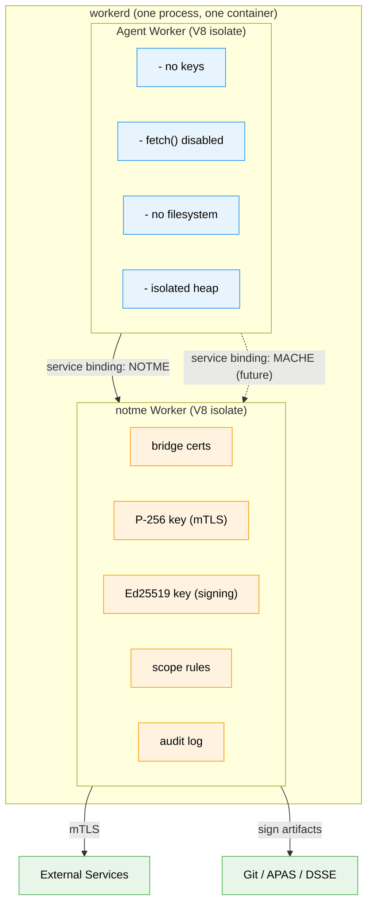
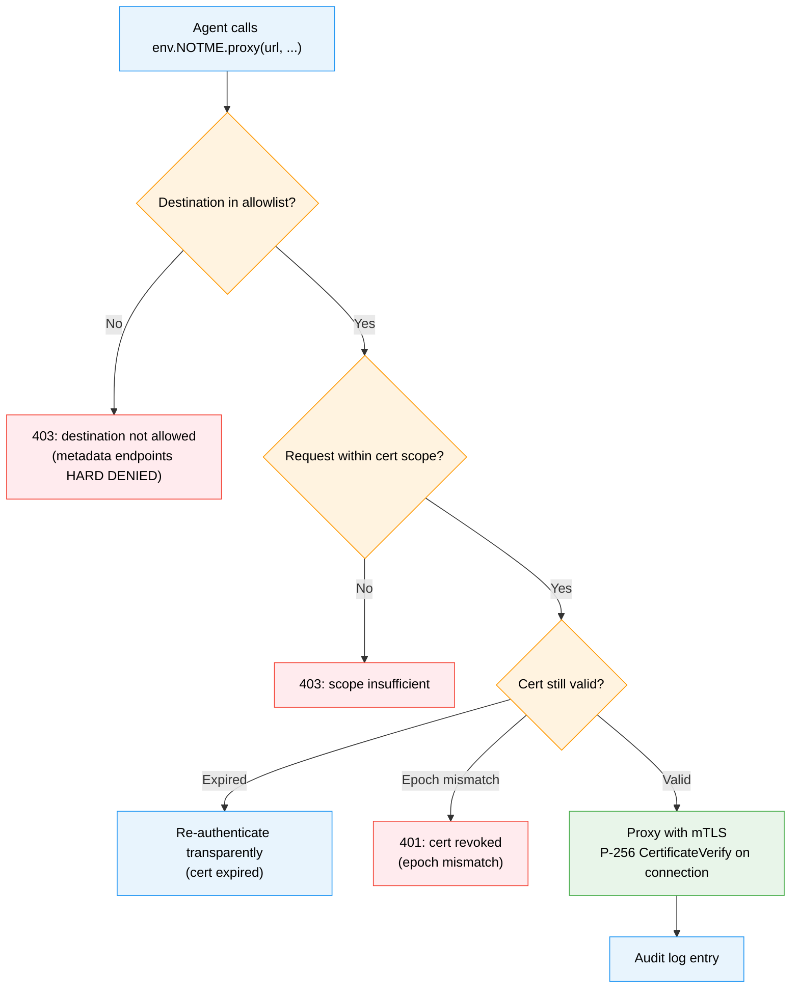
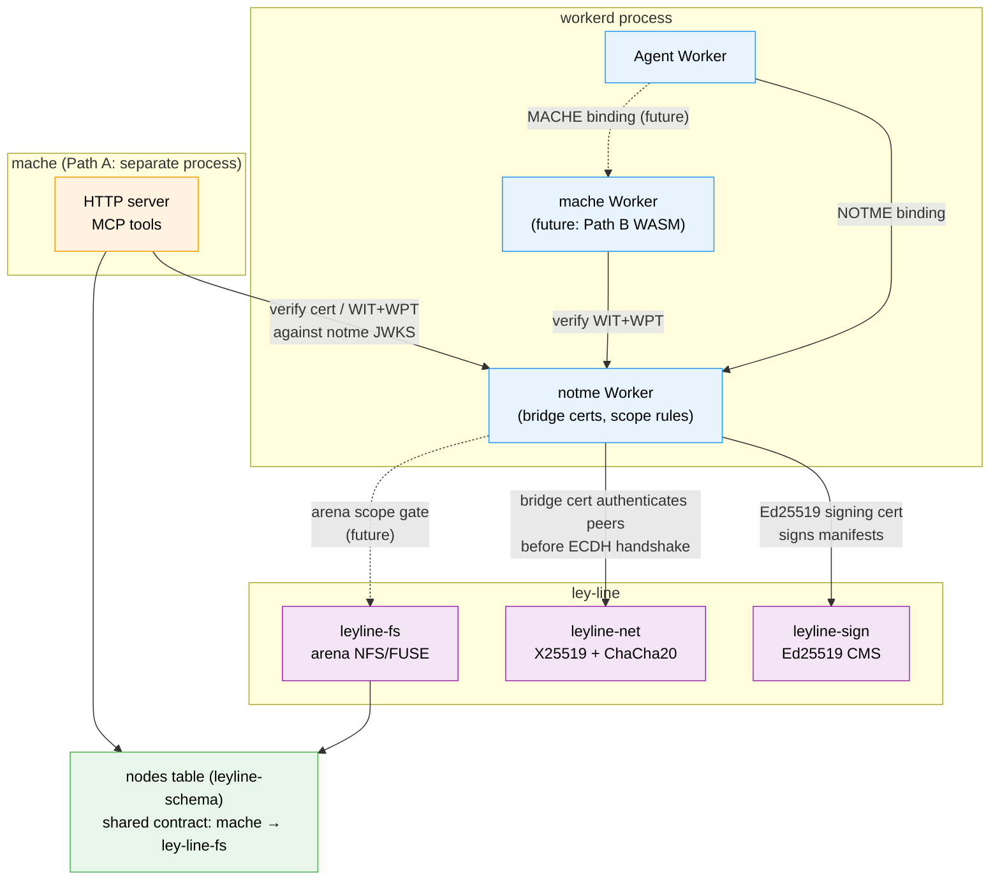
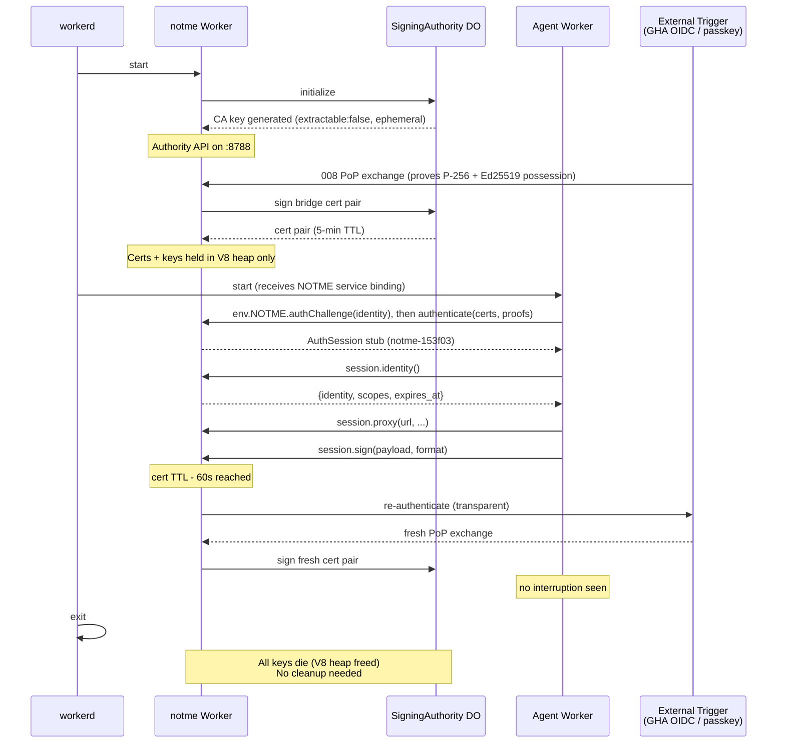

<!--
@doc-check
@endpoints: GET /.well-known/ca-bundle.pem
-->
# 009: Identity-Gated Runtime

**Status:** Partially implemented (audited 2026-08-04)

> `proxy/` exists and is tracked. The workerd service-binding topology this
> doc describes is not fully realised; treat the architecture section as
> intent, not as a description of the running system.

> One process. Isolated Workers. Service bindings. The agent can't reach the internet. The identity service can.

## Problem

008 defines how bridge certs are issued. This spec defines how they are **held, used, and enforced** — and how the identity service wires into the broader stack (mache, ley-line).

The traditional approach is a sidecar proxy (Istio/Envoy): a separate container that intercepts traffic. This adds operational complexity (two containers, shared networking, iptables rules) for what is fundamentally an in-process concern.

workerd (Cloudflare's open-source Workers runtime) provides **V8 isolate separation** between co-located Workers. One process, multiple Workers, service bindings for RPC. The isolation is the same mechanism that runs untrusted code on Cloudflare's edge. No separate container, no TCP, no UDS — the runtime IS the sandbox.

## Architecture



> V8 isolate boundary: Agent cannot read notme's memory, call fetch(), access the filesystem, or reach any network address.

### Why not a sidecar

| | Sidecar (Istio model) | Co-located Workers (this spec) |
|---|---|---|
| Processes | 2 (agent + proxy) | 1 (workerd) |
| Containers | 2 | 1 |
| IPC | TCP/UDS (syscalls, serialization) | Service binding (in-process, zero-copy) |
| Network enforcement | iptables/cgroup rules | `globalOutbound` not set → fetch() disabled |
| Sandbox | OS-level (namespaces, Landlock) | V8 isolate (same as CF edge, battle-tested) |
| Complexity | High (networking, port management) | Low (one capnp config) |

The container/sidecar model still works — workerd runs in Docker, and the same config applies. See [Container deployment](#container-deployment) for details.

## workerd configuration

```capnp
using Workerd = import "/workerd/workerd.capnp";

const config :Workerd.Config = (
  services = [
    # Identity + proxy service (has network access, holds keys)
    ( name = "notme",
      worker = .notmeWorker,
    ),

    # Agent service (network-isolated, talks to notme via service binding)
    ( name = "agent",
      worker = .agentWorker,
    ),

    # Internet access (only notme can use this)
    ( name = "internet",
      network = ( allow = ["public"] ),
    ),
  ],

  sockets = [
    # notme authority API (cert issuance, JWKS, discovery)
    ( name = "authority",
      address = "*:8788",
      http = (),
      service = "notme",
    ),
    # Agent entry point (if the agent exposes an API)
    ( name = "agent-api",
      address = "localhost:3000",
      http = (),
      service = "agent",
    ),
  ],
);

const notmeWorker :Workerd.Worker = (
  modules = [( name = "worker", esModule = embed "dist/notme.js" )],
  compatibilityDate = "2026-03-01",
  compatibilityFlags = ["nodejs_compat"],

  bindings = [
    ( name = "SITE_URL", text = "http://localhost:8788" ),
    ( name = "NOTME_KEY_STORAGE", text = "ephemeral" ),
    ( name = "SIGNING_AUTHORITY",
      durableObjectNamespace = "SigningAuthority" ),
    ( name = "REVOCATION",
      durableObjectNamespace = "RevocationAuthority" ),
  ],

  durableObjectNamespaces = [
    ( className = "SigningAuthority",
      uniqueKey = "signing-authority",
      enableSql = true ),
    ( className = "RevocationAuthority",
      uniqueKey = "revocation-authority",
      enableSql = true ),
  ],

  durableObjectStorage = (localDisk = "do-storage"),
  globalOutbound = "internet",  # notme CAN reach the internet (for JWKS, mTLS)
);

const agentWorker :Workerd.Worker = (
  modules = [( name = "agent", esModule = embed "dist/agent.js" )],
  compatibilityDate = "2026-03-01",

  bindings = [
    # The ONLY way the agent can interact with the outside world
    ( name = "NOTME", service = "notme" ),
  ],

  # NO globalOutbound — agent's fetch() goes nowhere
  # NO durableObjectStorage — agent has no persistent state
  # NO disk bindings — agent cannot read/write files
);
```

The critical line: `agentWorker` has **no `globalOutbound`**. The agent's `fetch()` function is disabled. The only external interaction is through the `NOTME` service binding.

## Service binding API

The agent Worker calls the notme Worker via the `NOTME` service binding. notme exports a `WorkerEntrypoint` with these RPC methods:

### Already implemented (in `worker.ts`)

```typescript
export class AuthService extends WorkerEntrypoint {
  // Mint a bridge cert for the subject the PROOF names. Takes evidence, not a
  // name: the DO re-verifies the envelope and derives the subject from the
  // verified claims (notme-51ccd7). This listing said `subject` until
  // rig-098326 — see the note below.
  async mintBridgeCert(proof: MintBridgeCertProof, publicKeyPem, ttlMs?)
    : Promise<{ ok: true; certificate; expires_at; subject; authority }
            | { ok: false; reason: BridgeCertRefusal }>

  // Get the authority's public key
  async getPublicKeyPem(): Promise<string>

  // Get the CA certificate
  async getCACertificatePem(): Promise<string>

  // Get authority state (epoch, seqno, keyId)
  async getAuthorityState(): Promise<AuthorityState>

  // Verify a session cookie
  async verifySession(cookie): Promise<Session | null>
}
```

**`mintDPoPToken` was on this surface and is gone (notme-d68da8).** It took
`{ sub, scope, audience, jkt }` and had the DO sign all four with the master
Ed25519 key. This ADR is where that exposure was decided, so this is where the
correction belongs: the binding holder this document grants the AUTH binding to
— "every agent Worker" — could therefore name the subject, the scope and the
audience of a genuine `at+jwt` carrying notme's real issuer, going around both
the session gate and the `getAllowedAudiences` check that `/token` and
`/authorize/token` enforce. rig/web, which holds a binding today, verifies
notme tokens on signature and `exp` alone and compares `claims.sub` to its
`ADMIN_USER_ID`: one call named rig's admin. Deleted rather than hardened — it
had no callers in any repo, and the live `/token` route calls the DO's
`mintDPoPTokenOnce` directly. Access tokens are now obtainable only through the
two session-gated HTTP routes.

The same correction applies to the `mintBridgeCert` line above, which this
document described as taking a `subject` string until rig-098326 went looking.
Both defects are the one failure mode: this ADR reasoned carefully about WHO
may hold the binding and not at all about WHAT the methods behind it believe.

### New methods (this spec)

> **CORRECTION (2026-11-04, `notme-153f03`).** These were first written as
> methods of `AuthService`. They are now methods of the `AuthSession` that
> `AuthService.authenticate()` returns; see "Authenticated sessions" below for
> why and how. `AuthService` itself offers `authChallenge()` and
> `authenticate()` and none of the three methods listed here, which moved to
> the session. The listing keeps its original signatures, with two
> differences: `request.method` is optional and defaults to `GET`, and
> `sign()` takes a third argument, the caller's `signer`, because notme holds
> no private key (see "Signing" below).

```typescript
export class AuthSession extends RpcTarget {
  // returned by AuthService.authenticate(); the caller holds a stub

  // Proxy an HTTP request with mTLS (agent calls this instead of fetch)
  async proxy(request: {
    url: string;
    method: string;
    headers?: Record<string, string>;
    body?: string;
  }): Promise<{
    status: number;
    headers: Record<string, string>;
    body: string;
  }>

  // Sign data as the session's identity: the caller's signer signs, and the
  // session verifies the result against the signing cert before returning it
  async sign(
    payload: ArrayBuffer,
    format: "raw" | "dsse" | "git-commit",
    signer: (payload: ArrayBuffer) => Promise<ArrayBuffer>,
  ): Promise<{
    signature: ArrayBuffer;
    certificate: string;  // signing cert PEM (public)
    identity: string;     // wimse:// URI
  }>

  // Get current identity and capabilities
  async identity(): Promise<{
    identity: string;     // wimse://notme.bot/...
    scopes: string[];
    certificates: { mtls: string; signing: string };
    expires_at: number;
  }>
}
```

### Agent usage

```typescript
// agent.js — runs in the isolated agent Worker
export default {
  async fetch(request, env) {
    // env.NOTME is the service binding to the notme Worker.
    // Prove possession of the cert pair and get a session (notme-153f03).
    // `using` disposes the stub at the end of the block, and notme then drops
    // the credentials the session held.
    const { challenge } = await env.NOTME.authChallenge(identity);
    using session = await env.NOTME.authenticate({
      mtlsCert, signingCert, challenge,
      proofs,            // both keys over authenticateBinding(..., challenge)
    });                  // no private key is passed, in any form

    // Make an authenticated request (no mTLS yet, see "Not yet" below)
    const response = await session.proxy({
      url: "https://api.github.com/repos/owner/repo",
      method: "GET",
      headers: { "Accept": "application/json" },
    });

    // Sign a git commit
    const commitData = new TextEncoder().encode("tree abc...\nauthor...\n\ncommit message");
    // `signingKey` stays in this isolate: the function crosses as a stub, and
    // notme calls back to it, then verifies the signature against the cert.
    const signed = await session.sign(commitData, "git-commit", (bytes) =>
      crypto.subtle.sign("Ed25519", signingKey, bytes));

    // Check identity
    const me = await session.identity();
    console.log(me.identity); // wimse://notme.bot/agent/dev-agent/dispatch/abc123

    // This DOES NOT WORK — agent has no globalOutbound:
    // await fetch("https://api.github.com/..."); // TypeError: fetch is not defined
  }
};
```

## Authenticated sessions (`notme-153f03`)

**The problem.** Each top-level call on a service binding reaches a fresh
`AuthService` instance; this was measured over a real loopback binding under
`notme-fbbfbc`. `authenticate()` used to store the certs it had verified on
`this`, so a later `env.NOTME.proxy()` or `env.NOTME.sign()` call found
nothing. Neither worked over a binding, which is the only way an agent Worker
reaches notme, and `identity()` answered "not authenticated" to a caller that
had just authenticated.

**The design.** `authenticate()` returns an `AuthSession`
(`worker/src/auth/auth-session.ts`), a class that extends `RpcTarget` from
`cloudflare:workers`. It holds the verified certs, the derived identity, the
scopes, the expiry, the epoch and, if one was given, the signing key.
`proxy()`, `sign()` and `identity()` are its methods. What the Workers RPC
documentation says makes this work:

- An `RpcTarget` returned from an RPC method "is not serialized, but is
  instead replaced by a stub … Calling any method on the stub actually makes
  an RPC back to the original object, where it was created"
  ([RPC, Class Instances](https://developers.cloudflare.com/workers/runtime-apis/rpc/#class-instances)).
  So the session's state stays in notme's isolate, and the agent holds only a
  handle.
- "As long as the stub still exists on the client, the corresponding object
  on the server cannot be garbage collected", and the server-side execution
  context "is implicitly extended until all such stubs are disposed"
  ([Lifecycle](https://developers.cloudflare.com/workers/runtime-apis/rpc/lifecycle/)).
  So the authenticated state lives exactly as long as the caller's stub.
- The stub is disposed explicitly with `stub[Symbol.dispose]()` or a `using`
  declaration, and automatically when the caller's execution context ends
  ("When an event handler is 'done', any stubs created as part of the event
  are automatically disposed"). The session implements `[Symbol.dispose]()`,
  which "runs after the last stub is disposed". It drops the held credentials
  and writes one `{"type":"session","event":"disposed"}` audit line. The
  documentation notes that the client does not wait for it, and that only
  `Symbol.dispose`, not `Symbol.asyncDispose`, is supported.
- A stub reaches properties and getters as well as methods ("Properties
  behave like RPC methods that don't take any arguments"). So every field of
  the session is ECMAScript `#private`, never TypeScript `private`, which is
  erased at build time. The session has no getters.

**What carried over.** Every `proxy()` gate in "Enforcement guarantees"
below runs on the session's `proxy()` unchanged: the destination denylist and
allowlist, the self-host rule, the `bridgeCert` scope, the per-call epoch
check, header stripping, `redirect: "manual"`, and one truthful audit line
per outcome. The epoch is read through `env` on each call, not through the
DO stub of the `authenticate()` call that created the session. `sign()`
keeps its scope check and audit line, and now also refuses expired certs and
a moved epoch (see "Signing" below).

**No cross-identity use.** A session is one proven identity for its whole
life. It has no method that re-authenticates or swaps what it holds. A caller
that wants a second identity calls `authenticate()` again and gets a second
session. The two do not share state, which `auth.session.isolation` pins over
the binding.

**Signing: the caller's key, notme's gates.** Private keys are never
exported, and workerd does not serialize a `CryptoKey` anyway
(`rpc.cryptokey.isolation`). So no private key crosses the binding in either
direction, and the session holds none: it keeps the signing cert's PUBLIC
key. `session.sign(payload, format, signer)` takes a `signer`, a function
that signs bytes with the caller's Ed25519 key. The Workers RPC
documentation says how that crosses a binding:

- "You can also send a function in the parameters of an RPC. This enables
  the 'server' to call back to the 'client', reversing the direction of the
  relationship." The function "is replaced by a 'stub'. The recipient can
  call the stub like a function, but doing so makes a new RPC back to the
  place where the function originated"
  ([RPC, Functions](https://developers.cloudflare.com/workers/runtime-apis/rpc/#functions)
  and [Send functions as parameters of RPC methods](https://developers.cloudflare.com/workers/runtime-apis/rpc/#send-functions-as-parameters-of-rpc-methods)).
  The key never leaves the agent's isolate; only the payload goes out and
  only the signature comes back.
- "When stubs are received in the parameters of an RPC, those stubs are
  automatically disposed when the call returns"
  ([Lifecycle](https://developers.cloudflare.com/workers/runtime-apis/rpc/lifecycle/#stubs-received-as-parameters-in-an-rpc-call)).
  The session does not keep the signer. It is passed on each `sign()` call
  and gone when that call returns.
- An `RpcTarget` stub "itself is not callable, but its methods are"
  ([Class Instances](https://developers.cloudflare.com/workers/runtime-apis/rpc/#class-instances)).
  `sign()` takes a function and nothing else, so it never has to guess which
  of the two it was handed. An agent whose signer is an `RpcTarget` passes
  `(bytes) => target.sign(bytes)`.

`sign()` runs its gates before it calls the signer. It needs credentials held
(not disposed) and unexpired, the scope (`dsse` and `git-commit` need
`sign:git` or `sign:attestation`), a signer, and the held certs' epoch equal
to the authority's. The epoch is the same revocation lever `proxy()` pulls,
which supersedes the earlier "`sign()` does not run the epoch check" note
below. It then hands the signer a private copy of the payload. It returns the
result only if the result verifies with the signing CERT's public key over
the original payload. A signer that throws is refused as `signer_failed`, and
a signature from another key or over other bytes is refused as
`signature_invalid`. Every outcome writes one `type: "sign"` audit line with
`allowed`, and a `reason` on refusal. So the signature, certificate and
identity `sign()` returns always agree, and the audit line records what was
actually produced. `authenticate()` takes no key in any form; an earlier
draft of this change took PKCS#8 bytes and was withdrawn.

**The old top-level methods.** `AuthService.proxy()`, `sign()` and
`identity()` are removed rather than kept as refusals. A name whose only
behaviour is to point somewhere else is surface with nothing behind it, and
workerd already refuses a call to a missing method ("The RPC receiver does
not implement …"). `rpc-surface.do.test.ts` pins both lists:
`AuthService` is `authChallenge`, `authenticate`, `getAuthorityState`,
`getCACertificatePem`, `getPublicKeyPem`, `mintBridgeCert` and
`verifySession`, and `AuthSession` is `identity`, `proxy` and `sign`, plus
the `Symbol.dispose` disposer.

**`authChallenge()` is rate limited.** Any binding holder can call it
without authenticating, and each call writes one PoP-nonce row in the
authority. It now spends the `CERT_LIMITER` binding (10 per 60 s per key)
under its own `authchallenge:` key prefix before it touches the DO. The key is
the calling binding's `props`, which the operator sets per binding. It is not
the requested identity, because the caller types that and could rotate it to
dodge a per-identity limit. **Bindings without `props` share one bucket.** A
caller that wants its own budget needs its binding to set `props` (in
`config.capnp`, `props = (json = "...")` on the service binding; a Worker
calling a loopback entrypoint passes `ctx.exports.AuthService({ props })`).

If `CERT_LIMITER` is not bound, as in a self-hosted workerd config without
it, `authChallenge()` does not fail open the way the HTTP routes' limiters
do. A fallback limiter enforces the same 10 per 60 s per key
(`worker/src/isolate-rate-limiter.ts`). **That fallback is per-isolate**:
its counts live in one isolate's memory, so each isolate (each Cloudflare
location, each workerd process, each restart) counts from zero. On a single
self-hosted workerd process that is a real bound. A Cloudflare deployment
binds `CERT_LIMITER` (`[[ratelimits]]`), so the fallback is not used there,
and it would be a weak substitute if it were. Its memory is capped at 1024 live
keys. Once all of them are in their window, a new key is refused rather than
admitted.

Covered by `auth.session.proxy`, `auth.session.sign`,
`auth.session.sign.wrong-key`, `auth.session.sign.signer-throws`,
`auth.session.disposed`, `auth.session.isolation`,
`auth.session.no-top-level` and `auth.session.challenge-throttled`
(`worker/src/auth-binding-session.do.test.ts`, over a real loopback binding
specialised with `props`), and by `auth.session.dispose`, `auth.sign.epoch`,
`auth.sign.expired`, `auth.sign.scope`, `auth.sign.verified`,
`auth.challenge.throttled`, `auth.challenge.keyed-by-binding`,
`auth.challenge.fallback` and `auth.challenge.per-binding`
(`worker/src/__tests__/auth-pop.test.ts`).

## Enforcement guarantees

> **CORRECTION (2026-11-02, `notme-c72e03`).** The isolation rows in the first
> table (no `globalOutbound`, V8 isolate boundary, no disk bindings, service
> binding as the only channel) are properties of the workerd config, not of
> notme code, and are unchanged by this note. The "Escalate scope" row and the
> flowchart below describe what was then `AuthService.proxy()` and is now
> `AuthSession.proxy()` (`worker/src/auth/auth-session.ts`, `notme-153f03`),
> which is listed above as already implemented — and four of its five gates
> differed from what that method did. **Updated 2026-11-03 (`notme-baea8c`).**
> What `proxy()` does now, in order — every step that refuses throws, and
> writes an audit line first:
>
> 1. Refuses (`not_authenticated`) if the session holds no certs, which is
>    the case once its stub has been disposed. A session exists only
>    after `authenticate()` has verified the certs against the CA AND the
>    caller has proved it holds both private keys (`notme-fbbfbc`): it calls
>    `authChallenge(identity)` for a challenge — single-use, at most 60 s
>    old, bound to that identity and to the calling binding's `props` when
>    set, spent in the authority's PoP-nonce store — signs
>    `authenticateBinding(mtlsSPKI, signingSPKI, challenge)`
>    (`worker/src/auth/cert-pair-binding.ts`, tag
>    `notme/authservice-authenticate/v1`) with each key, and passes certs,
>    challenge and proofs. Before this, any binding holder could present
>    another principal's public certs and be audited as them. The certs
>    live on the returned session, so `proxy()` and `sign()` work over a
>    real binding (`auth-binding-session.do.test.ts`); see "Authenticated
>    sessions" below.
> 2. Refuses (`credentials_expired`) if the held certs have expired. Nothing
>    re-authenticates transparently; the caller must call `authenticate()`
>    again.
> 3. Refuses (`destination_invalid`) if the URL does not parse, then
>    (`destination_denied`) if `isDeniedDestination(url)` is true: the hard
>    metadata denylist in `worker/src/destination-policy.ts`
>    (`169.254.169.254`, `metadata.google.internal`, `100.100.100.200`,
>    169.254.0.0/16, fc00::/7, fe80::/10, IPv4-mapped forms of those). No
>    configuration overrides it.
> 4. Refuses (`destination_not_allowed`) unless the URL is https and its host
>    is on `PROXY_ALLOWED_DESTINATIONS` — see "Destination allowlist" below.
>    **Unset or empty allows nothing.** Then refuses (`destination_self`) the
>    authority's own host — the hosts of `SIGNET_AUTHORITY_URL` and
>    `SITE_URL` — unless the allowlist names it exactly; a wildcard over the
>    authority's zone does not admit its admin surface.
> 5. Refuses (`scope_insufficient`) unless the held cert's scopes include
>    `bridgeCert`. This is a single capability check. The request carries no
>    scopes, so there is no `request.scopes ⊆ cert.scopes` relation to check.
> 6. Refuses (`epoch_mismatch`) unless the epoch both held certs carry
>    (`OID_EPOCH`, read and cross-checked by `authenticate()`) equals the
>    authority's current epoch (`getAuthorityState()`, one DO RPC per call).
>    `revokeEpoch()` and `rotate()` both move the epoch, so either stops held
>    certs at once instead of when they expire. Strict equality: a cert from a
>    later epoch than the authority's is refused too. If that RPC fails, the
>    request is refused (`authority_unavailable`), not sent.
> 7. Calls plain `fetch(url, { method, headers, body, redirect: "manual" })`,
>    with the caller's `Host`, `cf-*`, `x-forwarded-*`, `forwarded`,
>    `x-real-ip` and hop-by-hop headers (and any header its `Connection`
>    names) removed: on Cloudflare a `Host` or `cf-*` header can steer a
>    subrequest to a hostname the allowlist did not name.
>    A redirect is returned to the agent, not followed, so a listed host
>    cannot forward the request to one the allowlist refuses. The held P-256
>    cert is not attached; there is no mTLS on this path. (mTLS with the
>    bridge key is what the Rust proxy in `proxy/` does; that is a different
>    code path.)
> 8. Logs a JSON line with `allowed: true` and `response_status`, or, if the
>    fetch or the response body read throws, `allowed: true` and `error`.
>    Every refusal above logs `allowed: false` with `reason` naming its gate.
>    The logged `destination` drops userinfo and the fragment, replaces the
>    query with `?<redacted>`, and is capped at 512 characters; `method` at
>    16.
>
> Covered by `worker/src/__tests__/proxy-gates.test.ts` (`proxy.allowlist.*`,
> `proxy.epoch.*`, `proxy.audit.*`).
>
> Not yet:
> - no mTLS on outbound requests from `proxy()`. On Cloudflare, a Worker
>   presents a client certificate only through an `mtls_certificates`
>   binding, whose certificate is uploaded ahead of time
>   (`wrangler mtls-certificate upload`) and named by `certificate_id` in the
>   Wrangler config. The bridge cert `proxy()` holds is minted per session
>   with a key held only in memory, so it cannot be that certificate, and a
>   static operator certificate on the binding would present the operator's
>   identity, not the agent's — the opposite of what this ADR promises.
>   Self-hosted workerd is tracked under `notme-89eeed`. No code path is
>   added until one of those can present the held cert;
> - revocation is the epoch only. There is no per-certificate revocation
>   list for bridge certs to consult, so a single compromised cert is stopped
>   by `revokeEpoch()` (which stops every cert of its epoch) or by expiry;
> - (fixed, `notme-153f03`) `sign()` did not run the epoch check, on the
>   ground that every verifier checks the cert's epoch itself
>   (`verifyX509`). It now runs the same epoch check as `proxy()` and
>   refuses expired certs too, since a session can outlive them;
> - (fixed, `notme-bad2e5`) the IPv6 gap in the denylist: `new URL()` keeps
>   brackets on IPv6 hostnames, so the old `startsWith("fd00:")` test never
>   fired and IPv4-mapped literals slipped through. The policy now lives in
>   `worker/src/destination-policy.ts`, strips brackets, parses addresses to
>   bytes, and denies fe80::/10, fc00::/7, 169.254.0.0/16 and IPv4-mapped /
>   IPv4-compatible forms of denied IPv4s; covered by
>   `worker/src/__tests__/destination-policy.test.ts`.
>
> The table and flowchart below are kept as the original intent.

### What the agent CANNOT do

| Action | Why it's blocked |
|---|---|
| `fetch("https://...")` | No `globalOutbound` — fetch is undefined |
| Read notme's keys | V8 isolate boundary — separate heap, no shared memory |
| Access the filesystem | No disk bindings in agentWorker config |
| Bypass the proxy | Service binding is the only outbound channel |
| Escalate scope | notme checks `request.scopes ⊆ cert.scopes` before proxying |
| Read other Workers' state | V8 isolates are the same mechanism CF uses for multi-tenant edge |

### What the notme Worker checks before proxying



## Destination allowlist

```json
{
  "allowed": [
    "*.notme.bot",
    "api.github.com",
    "*.cloudflare.com"
  ],
  "denied": [
    "169.254.169.254",
    "metadata.google.internal",
    "100.100.100.200",
    "fd00:ec2::254"
  ]
}
```

Cloud metadata endpoints are hard-denied (same approach as [nono](https://nono.sh)). The allowlist is configured at startup via environment variable.

> **Updated 2026-11-03 (`notme-baea8c`).** The allowed half now exists.
> `PROXY_ALLOWED_DESTINATIONS` is a comma-separated list of hosts — not the
> JSON above — read on every call from the Worker's environment (a wrangler
> var, or a `text` binding in `config.capnp`). An entry is an exact host
> (`api.github.com`) or `*.` plus a suffix (`*.example.com`), which matches
> subdomains and not the apex. It is matched against the URL's host
> including any non-default port, and only https is proxied. Each entry is
> normalised by the WHATWG URL parser (a Unicode entry becomes its
> punycode). Dropped: a bare `*`, or a `*` anywhere but the leading label;
> anything that is not a bare host; a wildcard over an IP literal
> (`*.0.0.1`); and a wildcard over a single label or a known public suffix
> (`*.com`, `*.co.uk`) — that list is short and hand-kept, not the Public
> Suffix List. The JSON example above lists `*.notme.bot`; do not copy it:
> a wildcard over the authority's own zone would put its admin surface
> behind its own egress, which is why `proxy()` refuses the authority's own
> host unless it is listed exactly. **Unset or empty allows
> nothing** — this ADR did not say which way an unset list should fail, and
> an authority that has not said where its agents may go should send them
> nowhere, as an unset `GHA_ALLOWED_OWNERS` trusts no one (`notme-1532eb`).
> The denied half is still the hardcoded `DENIED_HOSTS` set plus IPv4/IPv6
> range checks, runs first, and is not overridden by listing a denied
> address.

## Audit trail

Every proxied request and signing operation is logged as structured JSON:

```json
{
  "ts": "2026-04-26T12:00:00Z",
  "type": "proxy",
  "identity": "wimse://notme.bot/agent/dev-agent/dispatch/abc123",
  "destination": "https://api.github.com/repos/owner/repo/pulls",
  "method": "POST",
  "scope_checked": "bridgeCert",
  "allowed": true,
  "response_status": 201,
  "duration_ms": 145
}
```

> **Updated 2026-11-03 (`notme-baea8c`).** For `type: "proxy"` entries,
> `allowed` is the decision: a refused request logs `allowed: false` with a
> `reason` naming the gate (`not_authenticated`, `credentials_expired`,
> `destination_invalid`, `destination_denied`, `destination_not_allowed`,
> `destination_self`, `scope_insufficient`, `authority_unavailable`,
> `epoch_mismatch`) before it throws, and has no `response_status`.
> `destination` is redacted (no userinfo or fragment, query replaced by
> `?<redacted>`, at most 512 characters).
> `identity` is `null` when nothing is held. `scope_checked` is still the
> constant `bridgeCert`, the only scope `proxy()` checks.

These logs feed into APAS attestations — the identity service IS the execution evidence for the agent's session. Each proxy/sign event becomes a verifiable entry in the provenance chain.

## Wiring: mache + ley-line integration



The co-located Worker model extends to the broader stack. The seams:

### mache (code intelligence)

mache is a Go binary that serves MCP tools over HTTP. Two integration paths:

**Path A (auth middleware):** mache stays as a separate process. notme adds auth middleware — mache verifies bridge cert or WIT+WPT on every MCP request against notme's JWKS.

**Path B (co-located):** mache compiles to WASM and runs as a Worker in the same workerd process. The agent calls mache via a service binding (`env.MACHE`). mache calls notme for auth. Zero HTTP overhead.

Path A is practical today. Path B requires mache's Go → WASM compilation (feasible — Go supports `GOOS=wasip1`).

### ley-line (transport + signing)

ley-line provides:
- **`leyline-net`**: UDP/TCP transport with X25519 ECDH handshake + ChaCha20-Poly1305
- **`leyline-sign`**: X.509 cert parsing + Ed25519 CMS signing
- **`leyline-fs`**: Arena mount (NFS/FUSE)

The wiring:
- **Manifest signing**: ley-line's TCP manifest includes an Ed25519 signature. Today this uses a local key. With notme, it uses the Ed25519 bridge cert — same key, same identity, verifiable by the receiver against notme's CA.
- **Transport auth**: The ECDH handshake in `leyline-net` establishes a session key. notme's bridge cert can authenticate the peers before the handshake — the receiver checks the sender's cert against the CA trust bundle.
- **Arena access**: ley-line's arena is mmap'd by both mache and ley-line-fs. Access control is filesystem-level today. With notme, arena access could be gated by bridge cert scope (e.g., `scope: arena:project-foo:read`).

### Shared contract: `nodes` table

mache ingests source code → populates a SQLite database with a `nodes` table (defined by `leyline-schema`). ley-line-open mounts that database via C FFI (`leyline-fs`). The `nodes` table is the shared contract between code intelligence and the filesystem layer.

notme doesn't touch this contract — it gates *who can query* (via mache auth) and *who can receive* (via ley-line transport auth), not *what the data looks like*.

## Credential lifecycle



## Container deployment

The workerd co-located model IS the container model. One Dockerfile:

```dockerfile
FROM notme:latest
COPY dist/agent.js /app/dist/agent.js
COPY config.capnp /app/config.capnp
# config.capnp defines both notme + agent Workers
ENTRYPOINT ["/usr/bin/workerd", "serve", "/app/config.capnp", "--experimental"]
```

For Docker Compose / Kubernetes where the agent is a separate image, the sidecar pattern still works — two containers sharing a network namespace. But the co-located model (one container, one workerd) is preferred because it's simpler and the V8 isolation is stronger than network namespace isolation.

## Relationship to nono

[nono](https://nono.sh) provides kernel-level sandboxing (Landlock/Seatbelt) and credential injection (phantom token pattern). notme provides cryptographic workload identity.

| Layer | nono | notme |
|---|---|---|
| Sandbox | Kernel (Landlock/Seatbelt) | V8 isolate (workerd) |
| Credentials | Injected (phantom token → real API key) | Issued (bridge cert, signed by CA) |
| Identity | None (uses injected creds) | WIMSE URI + cert chain |
| Audit | Kernel syscall log | Signed APAS attestation |

They compose: nono can sandbox the workerd process itself (restrict what workerd can do at the OS level), while workerd isolates the agent from the identity service internally.

## Success criteria

1. Agent Worker with no `globalOutbound` cannot call `fetch()` — confirmed by test
2. Agent can make authenticated requests via `session.proxy()` (the session `env.NOTME.authenticate()` returns) — mTLS verified by target service
3. Agent can sign artifacts via `session.sign()` — signature verifiable with bridge cert
4. `session.proxy()` rejects destinations not in allowlist
5. `session.proxy()` rejects requests exceeding cert scope
6. Cloud metadata endpoints hard-denied
7. Private keys never appear in any service binding response
8. Audit log captures every proxy + sign operation
9. Cert auto-renewal transparent to agent
10. Same config works in bare workerd, Docker, and GHA service container
