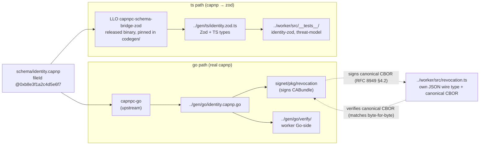

# schema

Cap'n Proto schemas — declared single source of truth for **type definitions** across TypeScript, Go, and Rust in the notme identity stack. **Wire formats are NOT defined here.**

## the layering (read this first)

| Layer | What it owns | Where |
|---|---|---|
| **Protocol** | wire formats, cryptographic operations, canonical-bytes-for-signing | [signet/](https://github.com/agentic-research/signet) (Go, the spec + reference implementation) |
| **Implementation** | secure deployed reference impl of the signet protocol on CF Workers | `notme/` (this repo) |
| **Type sync** | cross-language type definitions in lockstep | this directory — `schema/*.capnp` |

Capnp is the schema language for type sync. The wire format of any given message is determined by the protocol implementation (signet ADR-002 §2.3 for CABundle, RFC 5652 DER for CMS, RFC 9449 for DPoP, etc.).

## wire format split (per ADR-010)

| Surface | Format |
|---|---|
| HTTP API (request bodies, response bodies) | JSON |
| KV storage (`CA_BUNDLE_CACHE`) | JSON |
| DO SQLite blob columns | JSON |
| DPoP / JWT tokens | JSON-in-base64 (RFC 7515 / 9449) |
| **Cryptographic canonical bytes (Ed25519 sign/verify input)** | **canonical CBOR (RFC 8949 §4.2)** |

This matches signet exactly. signet's CABundle struct has `json:"..."` tags and is transported as JSON over HTTPS (`pkg/revocation/cabundle/https_fetcher.go`); the canonical CBOR form is computed in-memory via `cbor.CanonicalEncOptions().EncMode()` only at the moment a signature is produced or verified (`pkg/revocation/checker.go:168-188`).

## TS-side canonical-bytes encoder — alignment shipped

**Status (2026-05-10): aligned.** `worker/src/revocation.ts::bundleCanonical()` produces canonical CBOR with integer-keyed map (`{1:Epoch, 2:Seqno, 3:Keys, 4:KeyID, 5:PrevKeyID, 6:IssuedAt}`) per RFC 8949 §4.2 — byte-for-byte matching signet's `pkg/revocation/checker.go:168-188`. Hand-computed fixtures at `worker/src/__tests__/bundle-canonical.test.ts` lock the byte shape.

The previous JSON-of-sorted-keys path was a closed-loop-but-incompatible alternative; bundles now interoperate across signet implementations. Implemented per ADR-010 (`docs/design/010-cross-language-canonical-encoding.md`).

**If you are touching CABundle signature verification, oracle responses, or anything that assumes byte-equality of canonical bytes across languages — read ADR-010 first.**

## schema sync: closed

The hand-rolled `codegen/capnp-to-ts.ts`, which degraded silently on capnp it could not parse, is retired (notme-3e9c73). The TS side is now generated by ley-line-open's released `capnpc-schema-bridge-zod` plugin. It reads capnp's own compiled schema rather than parsing text, and it refuses any construct it cannot map. See [codegen](#codegen).

## flow

Neither generated artifact is a wire format notme speaks: the worker's JSON (`revocation.ts`, `cert-exchange.ts`, `gha-oidc.ts`) declares its own types, and signing input is canonical CBOR (ADR-010).

## type catalog

Every struct + enum in `identity.capnp`, grouped by section.

### revocation

| type | role |
|---|---|
| `CABundle` | The signed bundle of active CA keys. `epoch` mass-revokes on rotation, `seqno` is monotonic for rollback detection, `signature` is Ed25519 over the canonical bundle (excluding the signature field itself). The cross-language byte-equality of "canonical bundle" is the bug above. |
| `KeyEntry` | One CA public key inside a CABundle: `kid` + raw 32-byte Ed25519 `publicKey`. |
| `TokenClaims` | Embedded in issued tokens — pins the `keyId` + `epoch` they were issued under so the verifier can detect epoch drift. |
| `RevocationReason` (enum) | Why a token was rejected: `epochMismatch`, `unknownKey`, `rollbackAttack`, `bundleInvalid`, `bundleStale`. |
| `RevocationResult` | `{revoked, reason}` pair returned by the revocation check. |

### certificates (008)

| type | role |
|---|---|
| `BridgeCertResult` | **Legacy** single-cert result. `privateKey` field is deprecated-but-kept (always empty in 008+) for wire compat with old `DispatchPredicate.signingCert`. New code uses `BridgeCertPair`. |
| `BridgeCertPair` | The 008 dual-cert result: P-256 mTLS cert + Ed25519 signing cert + WIMSE identity URI + `binding` hash (SHA-256 over both SPKIs) proving they came from the same exchange. Carries `epoch` and `authMethod`. |
| `CertScope` (enum) | `bridgeCert` (standard agent), `authorityManage` (rotate epoch / register creds), `certMint` (delegated authority to issue certs). |
| `AuthorityState` | Worker's current `{epoch, keyId}` — published so signers know which epoch to bind to. |

### authentication

| type | role |
|---|---|
| `CertPairRequest` | 008 PoP cert exchange request. Bundles `{proof, publicKeys, proofs}`. |
| `CertPairPublicKeys` | The two SPKIs the caller wants signed: P-256 (mTLS) + Ed25519 (signing). |
| `CertPairPoP` | Two signatures over the binding payload — ES256 over the P-256 SPKI, EdDSA over the Ed25519 SPKI. Proves the caller holds both private keys. |
| `CertRequest` | **Legacy** single-cert request. `{scopes, proof}`. Replaced by `CertPairRequest` in 008. |
| `Proof` (union) | How the caller authenticated: `ghaOidc` (GHA OIDC token claims), `passkey` (WebAuthn credential ID), `bootstrapCode` (one-shot bootstrap string). |
| `GHAClaims` | The 16 fields lifted from a GitHub Actions OIDC JWT — issuer, sub, audience, jti (replay protection), repository, ref, sha, actor, workflow, jobWorkflowRef, runId, eventName, environment, etc. |

### APAS attestation

| type | role |
|---|---|
| `DispatchPredicate` | The DSSE payload signed when an agent is dispatched onto a bead. Carries `beadRef`, `agent`, `pipeline`, plus both legacy `signingCert :BridgeCertResult` (@3) and 008 `certPair :BridgeCertPair` (@4) for migration. |
| `BeadRef` | `{repo, beadId, contentHash}` — pins the bead and its content hash at dispatch time. |
| `AgentIdentity` | `{name, provider, model, definition}` — provider is `anthropic` / `openai` / etc., `definition` is the sha256 of the agent definition file. |
| `PipelineContext` | `{phases, currentPhase, pipelineId}` — UUID-pinned pipeline state. |
| `HandoffPredicate` | Phase-to-phase handoff DSSE payload. Carries `previousChainHash` + `chainHash` for the audit chain, plus both `signingCert` and `certPair` for the same migration reason as `DispatchPredicate`. |

### signing oracle (ssh-agent pattern)

The oracle protocol is the request/response between an agent and a key holder. The agent does its own TLS handshake but delegates the `CertificateVerify` signature to the oracle so the private key never enters the agent's process. Transport is whatever (UDS / service binding / HTTP); these structs are the protocol.

| type | role |
|---|---|
| `SignRequest` | `{digest, algorithm, purpose}`. `purpose` is an audit string (`tls-client-auth`, `git-commit`, `dsse-attestation`). |
| `SignResponse` | `{signature, identity}`. `identity` is the WIMSE URI of the signer for audit correlation. |
| `OraclePublicKey` | Public key + algorithm + bridge cert PEM + WIMSE identity + expiry. Public data only. |
| `OracleInfo` | What the oracle can do: `{keys, scopes, epoch}`. Typically two keys (P-256 + Ed25519). |

## schema evolution rules

Standard capnp discipline plus the workerd / Sandstorm conventions documented in the RTFM dossier (`ley-line-open/docs/decades/T8/capnp-rtfm-findings.md`):

1. **Append-only ordinals.** Add fields at the next `@N`. Never rename, never repurpose, never reuse. Removing a field is a breaking change.
2. **fileIds are stable** for the life of the file. `identity.capnp` is `@0xb8e3f1a2c4d5e6f7`. If the file moves or is renamed, the explicit ID stays.
3. **Deprecate, don't delete.** Use `# DEPRECATED:` docstring prefix (workerd convention). Live example: `BridgeCertResult.privateKey @1` is deprecated-but-kept; new code reads `BridgeCertPair`.
4. **No on-wire `schemaVersion`.** Capnp's fileId + ordinals + canonical form are the version surface. The RTFM specifically rejects on-the-wire version counters; workerd and Sandstorm both decline to embed one.
5. **Pure-struct schemas, no `interface`.** No live RPC in this layer; we emit data. Future RPC surfaces live in a separate file with a separate fileId.

## codegen

| command | output | toolchain |
|---|---|---|
| `task schema:zod` | `../gen/ts/identity.zod.ts` | ley-line-open's released `capnpc-schema-bridge-zod`, pinned in `codegen/` |
| `task schema:go` | `../gen/go/identity.capnp.go` | `capnpc-go` (upstream) |
| `task schema:all` | both | both |
| `task schema:zod:check` / `task schema:go:check` | diff — fails if that `gen/` file is stale relative to the schema (CI `schema` job) | each |
| `task schema:check` | type-checks `../gen/ts/identity.zod.ts` | `tsc` |

`gen/` IS committed — consumers don't re-run the generators on every build (matches the workerd / mache convention).

### the zod plugin

notme neither builds nor vendors the plugin. [`codegen/llo-release.json`](codegen/llo-release.json) pins an LLO release by tag, tag commit, the sha256 of that release's `SHA256SUMS`, which is vendored unmodified as [`codegen/SHA256SUMS`](codegen/SHA256SUMS), and the sha256 and size of each platform binary (darwin and linux, amd64 and arm64). `scripts/llo-schema-bridge.ts` downloads this host's binary into `node_modules/.cache/` and hands it to capnp only if it matches both the pin and the `SHA256SUMS` line. It re-hashes a cached copy on every run. `task docs:check` verifies the pins offline. LLO publishes no signature or attestation, so the pin is trust-on-first-use, the same as `../wasm/`. Re-pin with `task llo:schema-bridge -- --pin vX.Y.Z`, then run `task schema:zod` and review both diffs.

The plugin reads capnp's compiled `CodeGeneratorRequest`, not the schema text. It skips annotation declarations such as `$Go.*` and fails on any construct it cannot map, so nothing degrades to `z.unknown()`. What its output admits:

- objects are `.strict()`: unknown keys are rejected;
- a capnp `union` (`Proof`) is a zod union of single-key strict objects, so it takes exactly one variant;
- integers are `.int()`, with `.nonnegative()` for unsigned types. Neither the old generator nor this one bounds `UInt32` at 2³²−1;
- `Data` is `z.instanceof(Uint8Array)`;
- an absent scalar, enum, `Data` or `List` field takes its capnp zero value (LLO ADR-0004's append-only rule). An absent struct field is still an error. As a result `CABundleSchema.parse({})` succeeds, with an empty signature.

So the zod schemas describe the capnp structs, not notme's JSON wire, and they are not admission control. `../worker/src/__tests__/identity-zod.test.ts` pins every behaviour above, so a plugin re-pin that changes one fails there.

## toolchain pin status

Pinned. The capnp compiler is pinned by `CAPNP_VERSION` + `CAPNP_SHA256` in the root `Taskfile.yml`, and `capnpc-go` with its `std/go.capnp` by `../gen/go/go.mod` (notme-05324c). The zod plugin is pinned by `codegen/llo-release.json` (notme-3e9c73). A byte-equality fixture suite exists for the canonical CBOR signing input rather than capnp: `fixtures/`, pinned by `fixtures/SHA256SUMS` and checked by `task docs:check` (notme-1629fe).

## related

- **`../gen/`** — generated TS + Go output, both committed.
- **`../worker/src/revocation.ts`** — declares its own JSON `CABundle` type (keys as a kid → base64 map); it does not import `gen/ts`. `bundleCanonical()` produces the canonical CBOR signing input (ADR-010).
- **`../worker/src/cert-exchange.ts`** — implements the 008 PoP exchange that `BridgeCertPair` / `CertPairRequest` / `CertPairPoP` describe, with its own snake_case JSON types.
- **`../docs/design/008-bridge-cert-csr-wimse.md`** — what `BridgeCertPair` represents.
- **`../docs/design/006-dpop-tokens.md`** — DPoP wire format (TS-only, separate file at `packages/dpop`).
- **`signet/pkg/revocation/types.go`** — Go-side mirror that signs `CABundle` for the Worker to verify.
- **`ley-line-open/docs/decades/T8/capnp-rtfm-findings.md`** — canonical-encoding rules, fileId discipline, version-counter analysis. Read before changing anything in this directory.
